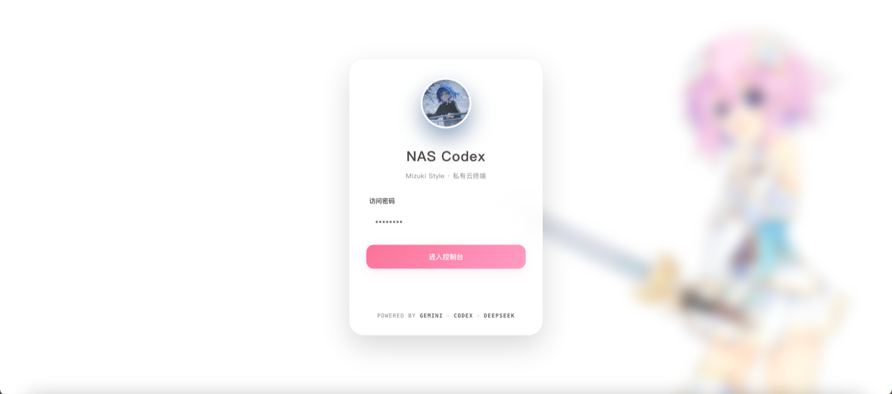
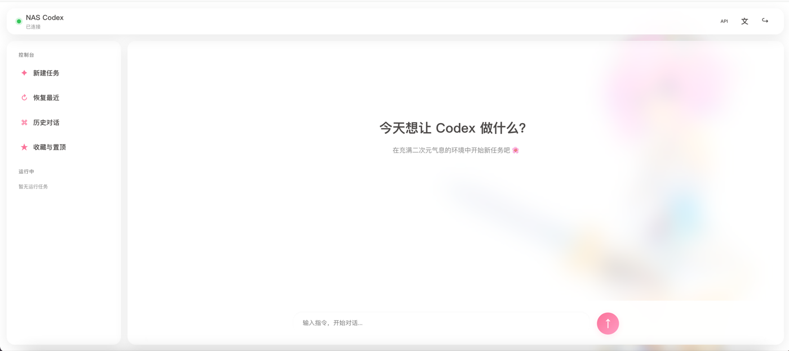

# Codex NAS Console

**Language:** [简体中文](README.md) | English

Run OpenAI Codex CLI on a home NAS from a browser, phone, tablet, or SSH terminal.

This is a **web-first** Codex console for NAS owners. Open a browser to start tasks, watch execution, resume conversations, manage history, and switch models. A Shell menu is included for advanced users, but it is not required for everyday use.

The frontend is one `index.html`; the backend is one `server.js`. There is no React/Vue app, no `npm build` step, and no database service. Deploy once and get an app-like experience for the whole household.

> Built with Codex and maintained and tested by [sd24dghe](https://github.com/sd24dghe).

## Screenshots

| Glass login screen | Live task console |
| --- | --- |
|  |  |

## Why Use It

- **Complete browser workflow**: task creation, progress states, tool calls, conversation history, favorites, and provider settings are designed around Codex rather than a terminal embedded in a page.
- **Real-time feedback**: SSE streams analysis states, tool commands, command output, final messages, and token usage.
- **Phone and tablet ready**: responsive layout, touch-sized controls, translucent hierarchy, and dark mode.
- **Featherweight**: no frontend build, database server, or web framework. Configuration and history remain ordinary files.
- **Friendly API switching**: edit Base URL, model, API key, and protocol in the browser; discover models and test the connection.
- **Share it with the household**: deploy once on a NAS and use it from phones, tablets, and laptops.
- **Terminal power remains available**: the optional `codex-nas` menu and tmux cover advanced SSH workflows.

## Features

- Web console with password authentication
- Server-Sent Events for live Codex status, tool calls, and responses
- Markdown and LaTeX rendering
- New tasks, recent conversations, history, favorites, pinning, archive, and delete
- Runtime API settings for base URL, model, API key, and wire protocol
- Model discovery through an OpenAI-compatible `/models` endpoint
- Persistent Codex authentication and conversation history
- Mobile-friendly `codex-nas` tmux menu for SSH clients
- Docker restart policy and health check
- API keys stay in a bind-mounted file, not in the image or Compose environment

## Architecture

```text
Browser / phone / iPad
          |
       SSE + HTTP
          |
   Node.js web server :8787
          |
       Codex CLI
          |
   workspace + ~/.codex
```

The web server and shell menu share the same Codex configuration:

```text
data/codex/config.toml
data/codex/auth.json
data/codex/AGENTS.md
data/codex/favorites.tsv
```

## Requirements

- Docker Engine 24+ with Docker Compose v2
- A NAS, Linux server, or macOS host
- Access to an OpenAI-compatible API
- Approximately 2 GB of free disk space for the base image and browser dependencies

## Step-By-Step Installation

These steps assume you can SSH into your NAS. Copy the commands in order.

### Step 0: Check Docker

```bash
docker --version
docker compose version
```

Continue when both commands print a version.

### Step 1: Download the project

```bash
git clone https://github.com/sd24dghe/codex-nas.git
cd codex-nas
```

You can also download the GitHub ZIP and extract it.

### Step 2: Create the web password

```bash
cp .env.example .env
openssl rand -base64 32
```

Open `.env` and set:

```text
CODEX_WEB_PASSWORD=your-generated-password
```

The default data directory is `./data`. To use a NAS volume:

```text
CODEX_DATA_DIR=/path/on/your/nas/codex-data
```

Do not commit `.env`; Git ignores it.

### Step 3: Build and start

```bash
docker compose up -d --build
docker compose ps
```

Wait for `healthy` or `running`.

```bash
docker compose logs -f --tail=100
```

Press `Ctrl+C` to leave the log view without stopping the container.

### Step 4: Open the web console

From the same LAN:

```text
http://NAS-LAN-IP:8787
```

Example:

```text
http://192.168.1.20:8787
```

Sign in with `CODEX_WEB_PASSWORD`.

### Step 5: Configure the model API

Click **API** in the top-right corner:

- **Provider preset**: choose DeepSeek or a custom compatible provider
- **API Base URL**: provider endpoint
- **Model**: model identifier
- **API Key**: provider credential
- **Protocol**: `Responses API` or `Chat Completions`

Click **读取模型列表** to query `/models`, then **保存并测试**.

A blank API Key preserves the existing saved key. New settings affect newly started or resumed tasks; running tasks are not interrupted.

### Step 6: Run the first task

1. Click **New task**
2. Enter the task
3. Keep the working directory as `/app`, or choose a subdirectory
4. Start the task

The page streams analysis states, commands, command output, final messages, and token usage.

### Step 7: Use it from a phone or tablet

```text
http://NAS-LAN-IP:8787
```

Use “Add to Home Screen” in Safari or Chrome. For remote access, prefer Tailscale, Cloudflare Tunnel, or an HTTPS reverse proxy. Do not publish plain HTTP directly to the internet.

## API Key Storage

The API key is stored only on the host:

```text
data/codex/auth.json
```

The server applies mode `0600`. It is not copied into the Docker image, passed in Compose environment variables, or returned by an API response.

The web login password is read from `.env` and passed to the container as `CODEX_WEB_PASSWORD`.

Before publishing a fork:

```bash
git status --ignored
git grep -nE 'sk-|api[_-]?key|password|token'
```

Never commit `.env` or `data/`.

## Advanced: Shell Menu

Everyday use can happen entirely in the browser. The Shell menu is intended for batch workflows, long-running tmux tasks, SSH users, and terminal-heavy work.

Install the host-side helper:

```bash
sudo scripts/install-shell.sh
codex-nas
```

The script automatically detects the host directory mounted at `/root/.codex` in the running container. To override it:

```bash
export CODEX_NAS_DATA_DIR=/path/to/data
```

The menu provides:

1. New Codex task
2. Resume the latest conversation
3. Browse history
4. Favorites, pin, archive, and delete
5. Attach to a running task
6. Container shell
7. Stop running tasks
8. Response language
9. API and model settings

Each named task runs in a tmux session. Detach with `Ctrl+B`, then `D`. Reconnect with the same task name.

## Mobile And Tablet

Use any SSH client, such as Termius or Blink Shell:

```bash
ssh your-user@your-nas
codex-nas
```

For browser use, add `http://NAS-LAN-IP:8787` to the home screen. Connections dropped from a mobile browser do not stop tasks executed inside tmux.

## Persistent Data

By default, Compose stores data under `./data`:

```text
data/app        Codex workspace
data/codex      Codex config, auth, history, favorites
data/claude     Optional Claude config
data/config     General config
```

Change `CODEX_DATA_DIR` in `.env` to use another NAS volume.

## Theme Customization

- Put a local image at `app/avatar.jpg` before building to replace the default `NAS` avatar.
- `app/avatar.jpg` is ignored by Git so private or copyrighted artwork is not published accidentally.
- To use a wallpaper, edit the `--wallpaper-image` value in `app/index.html`. No third-party wallpaper URL is loaded by default.

## Reverse Proxy

Caddy example:

```caddyfile
codex.example.com {
    reverse_proxy 127.0.0.1:8787
}
```

The Node server supports SSE and disables proxy buffering headers for event streams. For public access, put the service behind HTTPS and an additional access layer such as Cloudflare Access, Tailscale, or a VPN.

## GitHub Publishing

```bash
git init
git add .
git commit -m "Initial Codex NAS console"
gh repo create codex-nas --public --source=. --remote=origin --push
```

Review the repository contents before pushing. Do not publish your real `.env`, `data/`, API keys, personal domains, or private wallpaper and avatar assets.

## Updating

```bash
git pull
docker compose up -d --build
```

Codex conversations and provider settings remain in `data/codex`.

## Author

- Bilibili: [sd24dghe](https://space.bilibili.com/1502095394)
- GitHub: [sd24dghe](https://github.com/sd24dghe)
- Built with Codex; maintained and tested by sd24dghe.

## Contributing

Bug reports, compatibility findings, documentation fixes, and feature
discussions are welcome. Open an issue before a large feature or refactor.

- [Contributing guide](CONTRIBUTING.md)
- [Bug report](https://github.com/sd24dghe/codex-nas/issues/new?template=bug_report.yml)
- [Feature request](https://github.com/sd24dghe/codex-nas/issues/new?template=feature_request.yml)

The maintainer is a high-school student. Reviews and replies are best-effort.

## Security

Use GitHub Private Vulnerability Reporting:

https://github.com/sd24dghe/codex-nas/security/advisories/new

The fallback contact is a [Bilibili private message](https://space.bilibili.com/1502095394). Do not post API keys, passwords, private NAS addresses, or conversation contents in a public issue.

## License

This project is released under the [MIT License](LICENSE). You may use, copy,
modify, merge, publish, distribute, sublicense, and sell copies while keeping
the copyright and permission notice.

## Notes

- The web server runs Codex as a child process and streams JSONL events.
- The container runs Codex with `danger-full-access`. Docker is the isolation boundary; Codex can modify files under the mounted `/app` workspace.
- The application does not expose hidden chain-of-thought. It shows available Codex statuses, tool calls, outputs, and final messages.
- Use only one trusted administrator account unless you add a multi-user authentication layer.
