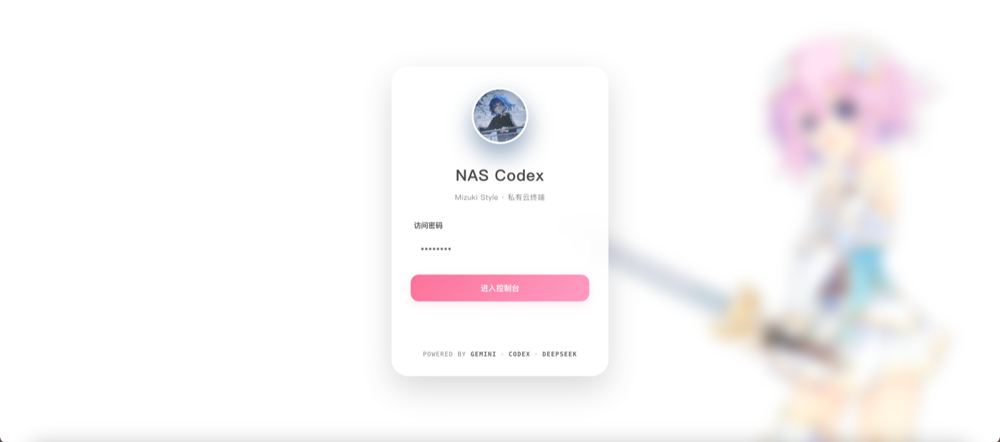
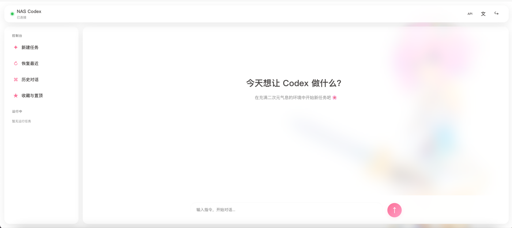

# Codex NAS Console

**语言：[English](README.en.md) | 简体中文**

在家庭 NAS 上运行 OpenAI Codex CLI，并通过网页、手机、平板或 SSH 终端使用。

这是一个**网页端优先**的 Codex NAS 控制台：打开浏览器就能发起任务、观察执行过程、恢复对话、管理历史和切换模型。项目同时提供 Shell 菜单，但它是面向进阶用户的补充入口，不是使用门槛。

整个前端只有一个 `index.html`，后端只有一个 `server.js`。无需 React/Vue、无需 `npm build`、无需数据库服务，部署后即可获得接近原生 App 的操控体验。

> 本项目由 Codex 协作编写，由 [sd24dghe](https://github.com/sd24dghe) 维护与测试。

> **小白必读：** 使用 Docker Compose 部署时，Codex CLI 已包含在镜像中，**不需要在 NAS 宿主机上另外安装**。只有不用 Docker、直接运行 `server.js`，或者手动在宿主机使用 Codex CLI 时，才需要自行安装。

## 先看效果

| 毛玻璃登录页 | 实时任务控制台 |
| --- | --- |
|  |  |

## 为什么值得用

- **网页操控体验完整**：不是简单把终端塞进网页，而是围绕 Codex 的工作流设计任务、状态、工具调用、历史和设置。
- **实时反馈**：通过 SSE 持续显示“正在分析”、工具命令、命令输出、最终回答和 token 使用情况。
- **手机和平板友好**：响应式布局、触屏尺寸、毛玻璃层级和深色模式，适合在 iPad/手机上查看任务。
- **轻量到几乎没有部署负担**：无需前端构建、无需数据库、无需额外 Web 框架；数据保存为普通文件。
- **切换 API 很直观**：网页里可以修改 Base URL、模型、API Key 和协议，支持读取模型列表和测试连接。
- **全家可共享**：一个 NAS 部署，多台手机、平板、电脑通过局域网或反向代理访问。
- **本地能力不丢**：需要更强的终端操作时，可继续使用 `codex-nas` Shell 菜单和 tmux。

## 功能

- 带密码认证的 Web 控制台
- 使用 Server-Sent Events 实时显示 Codex 状态、工具调用和回答
- 渲染 Markdown 和 LaTeX 公式
- 新建任务、最近对话、历史、收藏、置顶、归档和删除
- 在网页或 Shell 中修改 Base URL、模型、API Key 和请求协议
- 通过 OpenAI 兼容 `/models` 接口自动读取模型列表
- 持久化 Codex 登录状态和对话历史
- 手机友好的 `codex-nas` tmux SSH 菜单
- Docker 自动重启与健康检查
- Docker 镜像自动安装 Codex CLI，Shell 菜单可检查或修复
- API Key 保存在绑定挂载文件中，不打进镜像或 Compose 环境变量

## 架构

```text
浏览器 / 手机 / iPad
          |
       SSE + HTTP
          |
   Node.js Web 服务 :8787
          |
       Codex CLI
          |
   工作目录 + ~/.codex
```

Web 服务与 Shell 菜单共用同一套 Codex 配置：

```text
data/codex/config.toml
data/codex/auth.json
data/codex/AGENTS.md
data/codex/favorites.tsv
```

## 环境要求

- Docker Engine 24+ 与 Docker Compose v2
- NAS、Linux 主机或 macOS 主机
- 可访问 OpenAI 兼容 API
- 约 2 GB 可用磁盘空间，用于基础镜像和浏览器依赖

## 详细部署教程

以下步骤默认你已经可以通过 SSH 登录 NAS。只需要复制命令并依次执行。

### 第 0 步：确认 Docker 正常

```bash
docker --version
docker compose version
```

如果两个命令都能输出版本号，就可以继续。

### 第 1 步：下载项目

```bash
git clone https://github.com/sd24dghe/codex-nas.git
cd codex-nas
```

没有 Git 时，也可以从 GitHub 下载 ZIP，解压后进入目录。

### 第 2 步：生成网页登录密码

```bash
cp .env.example .env
openssl rand -base64 32
```

复制生成出来的随机字符串，然后编辑 `.env`：

```text
CODEX_WEB_PASSWORD=粘贴刚才生成的密码
```

默认数据保存到项目内的 `data/`。如果你想指定 NAS 存储卷，修改：

```text
CODEX_DATA_DIR=/你的/NAS/路径/codex-data
```

`.env` 包含登录密码，已被 `.gitignore` 忽略，不要上传 GitHub。

### 第 3 步：构建并启动

```bash
docker compose up -d --build
docker compose ps
```

看到 `healthy` 或 `running` 即可。

查看日志：

```bash
docker compose logs -f --tail=100
```

按 `Ctrl+C` 退出日志查看，不会停止容器。

### 第 4 步：打开网页

在同一个局域网内访问：

```text
http://NAS的局域网IP:8787
```

例如：

```text
http://192.168.1.20:8787
```

打开后会先看到毛玻璃登录页。输入 `.env` 中设置的 `CODEX_WEB_PASSWORD`。

### 第 5 步：配置模型 API

登录后点击右上角 **API**：

- **快速预设**：可以直接选择 DeepSeek 官方 API
- **API Base URL**：服务商接口地址
- **模型名称**：模型 ID
- **API Key**：服务商密钥
- **请求协议**：`Responses API` 或 `Chat Completions`

推荐先点击 **读取模型列表** 或 **测试当前配置**。验证通过后点击 **保存设置**。

API Key 留空时会保留上一次保存的 Key。配置会立即生效，新任务使用新模型，已经在运行的任务不会中途切换。

新版 API 面板会先显示当前生效的模型、接口、协议和 Key 状态。**测试当前配置**与**读取模型列表**只验证正在编辑的内容，不会覆盖现有配置；确认无误后再点击**保存设置**。

### 第 6 步：开始第一个任务

1. 点击 **新建任务**
2. 填写任务内容
3. 保持工作目录为 `/app`，或填写 `/app` 下的子目录
4. 点击开始

页面会实时显示：

- Codex 正在分析
- 执行的命令
- 命令输出
- 最终回答
- token 使用情况

### 第 7 步：手机或平板访问

手机和 NAS 在同一网络时，直接打开：

```text
http://NAS局域网IP:8787
```

在 Safari 或 Chrome 中选择“添加到主屏幕”，即可像 App 一样启动。

如果需要从外网访问，推荐使用 Tailscale、Cloudflare Tunnel 或配置 HTTPS 反向代理，不要把明文 HTTP 端口直接暴露到公网。

## 预构建镜像与 Docker Hub

默认的 `docker-compose.yml` 会在 NAS 本地构建镜像，**不要求 Docker Hub 账号**。

需要直接拉取预构建镜像时使用：

```bash
docker compose -f docker-compose.image.yml up -d
```

镜像地址：

```text
ghcr.io/sd24dghe/codex-nas:latest
```

在 `.env` 中可以固定版本：

```text
CODEX_IMAGE_TAG=main
```

`latest` 和 `main` 会持续更新；之后的版本 Tag 也会生成对应镜像标签。Docker Hub 完全可选；当前 GHCR 方案不需要额外注册表凭据。

## 原生 Node.js 部署（不使用 Docker）

Docker 模式无需执行这一节。原生部署更轻，但需要自己安装并保活 Node.js 与 Codex CLI。

需要 Node.js 20 或更高版本：

```bash
node --version
npm --version
npm install -g @openai/codex
codex --version
```

下载项目并设置运行目录与网页登录密码：

```bash
git clone https://github.com/sd24dghe/codex-nas.git
cd codex-nas
mkdir -p data/app data/codex

export CODEX_WEB_PASSWORD='自己设置一个强密码'
export CODEX_WEB_PORT=8787
export CODEX_HOME="$PWD/data/codex"
export CODEX_WEB_WORKSPACE="$PWD/data/app"

node app/server.js
```

看到 `NAS Codex Web listening` 后，访问 `http://NAS的局域网IP:8787`。模型与 API Key 直接在本项目的 **API** 面板配置，不需要先运行 `codex login`。

关闭 SSH 后仍要运行，可以使用 NAS 自带的任务计划、systemd 或进程守护工具启动同一行 `node app/server.js`。请在守护工具中配置上面的环境变量，不要把密码和 API Key 写进 GitHub。

`codex-nas` Shell 菜单中的 **10) 检查 / 安装 Codex CLI** 只操作 Docker 容器。原生 Node.js 部署可直接运行 `npm install -g @openai/codex` 更新 CLI。

### `config.toml` 报 `duplicate key`

`v0.1.1` 已修复保存 API 时重复追加 `[model_providers.*]` 内容的问题。先更新代码并重启 Node.js 服务。如果旧配置已经损坏，请备份 `CODEX_HOME/config.toml`，然后从 API 面板重新保存一次；不要在同一个提供方表中手工添加多组 `name`、`base_url` 或 `wire_api`。

修复仍保持“单 `index.html` + 单 `server.js` + 少量辅助脚本”的结构，没有新增常驻依赖或数据库。

## API Key 存储

API Key 只保存在宿主机：

```text
data/codex/auth.json
```

服务端会将该文件权限设置为 `0600`。Key 不会写入 Docker 镜像、Compose 环境变量，也不会通过 API 响应返回。

网页登录密码从 `.env` 读取，并以 `CODEX_WEB_PASSWORD` 传入容器。

发布项目或 Fork 前建议检查：

```bash
git status --ignored
git grep -nE 'sk-|api[_-]?key|password|token'
```

不要提交 `.env` 或 `data/`。

## 进阶：Shell 菜单

大多数日常操作可以完全在网页端完成。Shell 菜单主要适合批量操作、长期后台任务、SSH 工作流和需要终端能力的用户。

安装宿主机脚本：

```bash
sudo scripts/install-shell.sh
codex-nas
```

脚本会自动识别容器中 `/root/.codex` 对应的宿主机挂载目录。需要手动指定时：

```bash
export CODEX_NAS_DATA_DIR=/path/to/data
```

菜单功能：

1. 新建 Codex 任务
2. 恢复最近一次对话
3. 浏览历史对话
4. 收藏、置顶、归档和删除
5. 连接正在运行的任务
6. 进入容器 Shell
7. 结束运行中的任务
8. 切换回答语言
9. 修改 API 与模型
10. 检查 / 安装 Codex CLI

每个任务在独立 tmux 会话中运行。按 `Ctrl+B` 再按 `D` 脱离，重新执行同名任务即可恢复。

## 手机与平板

使用 Termius、Blink Shell 等 SSH 客户端：

```bash
ssh 你的用户名@NAS地址
codex-nas
```

浏览器端可以把 `http://NAS局域网IP:8787` 添加到主屏幕。移动浏览器断开不会停止 tmux 中的任务。

## 持久化目录

默认情况下，Compose 数据位于 `./data`：

```text
data/app        Codex 工作区
data/codex      Codex 配置、认证、历史、收藏
data/claude     可选 Claude 配置
data/config     通用配置
```

可以在 `.env` 中修改 `CODEX_DATA_DIR`，指定其他 NAS 存储卷。

## 主题定制

- 构建前将本地图片保存为 `app/avatar.jpg`，可替换默认的 `NAS` 头像。
- `app/avatar.jpg` 被 Git 忽略，避免误发布私人或受版权保护素材。
- 如需壁纸，请修改 `app/index.html` 中的 `--wallpaper-image`。默认不会加载第三方壁纸。

## 反向代理

Caddy 示例：

```caddyfile
codex.example.com {
    reverse_proxy 127.0.0.1:8787
}
```

Node 服务支持 SSE，并针对事件流禁用代理缓冲。公网访问建议使用 HTTPS，并叠加 Cloudflare Access、Tailscale 或 VPN 等额外访问层。

## 发布到 GitHub

```bash
git init
git add .
git commit -m "Initial Codex NAS console"
gh repo create codex-nas --public --source=. --remote=origin --push
```

推送前检查仓库内容。不要发布真实的 `.env`、`data/`、API Key、私人域名、壁纸或头像素材。

## 更新

```bash
git pull
docker compose up -d --build
```

Codex 对话和 API 设置会保留在 `data/codex`。

## 作者与致谢

- Bilibili：[sd24dghe 的主页](https://space.bilibili.com/1502095394)
- GitHub：[sd24dghe](https://github.com/sd24dghe)
- 本项目由 Codex 协作编写，sd24dghe 维护与测试。

## 参与贡献

Bug、兼容性反馈、文档修正和功能讨论都欢迎。提交大型功能前请先开 Issue 讨论，避免重复实现或方向不一致。

- [贡献指南](CONTRIBUTING.md)
- [Bug 报告](https://github.com/sd24dghe/codex-nas/issues/new?template=bug_report.yml)
- [功能建议](https://github.com/sd24dghe/codex-nas/issues/new?template=feature_request.yml)

维护者是高中在读学生，回复和处理会尽力而为，感谢理解。

## 安全

请优先使用 GitHub 私有漏洞报告：

https://github.com/sd24dghe/codex-nas/security/advisories/new

备用联系方式是 [B 站私信](https://space.bilibili.com/1502095394)。不要在公开 Issue 中发布 API Key、密码、私人 NAS 地址或对话内容。

## 许可证

本项目使用 [MIT License](LICENSE)。允许使用、复制、修改、合并、发布、分发、再许可和销售，只需保留版权与许可声明。

## 说明

- Web 服务以子进程方式运行 Codex，并解析 JSONL 事件流。
- 容器中的 Codex 使用 `danger-full-access`。Docker 是隔离边界，Codex 可以修改挂载到 `/app` 的工作区文件。
- 应用不会暴露隐藏的思维链，只展示 Codex 提供的状态、工具调用、输出和最终消息。
- 默认仅支持一个可信管理员账号；如需多用户，请增加独立认证层。
